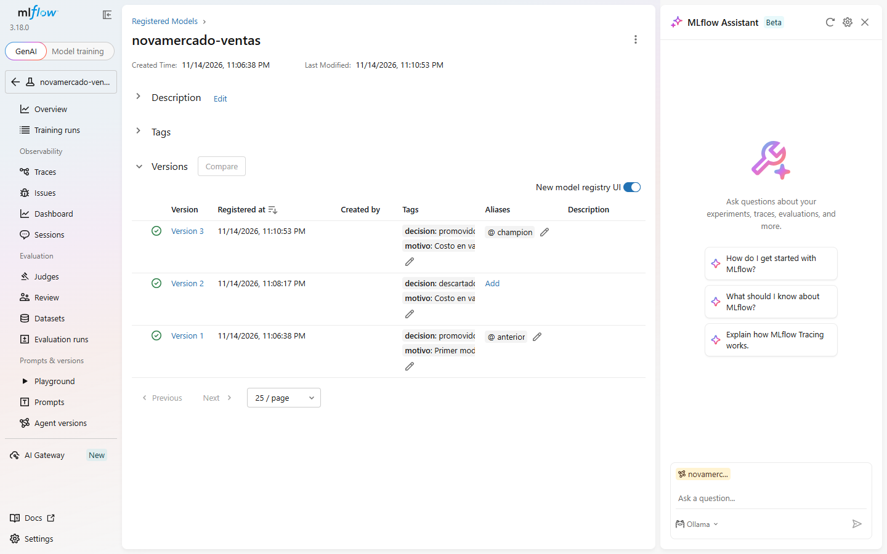
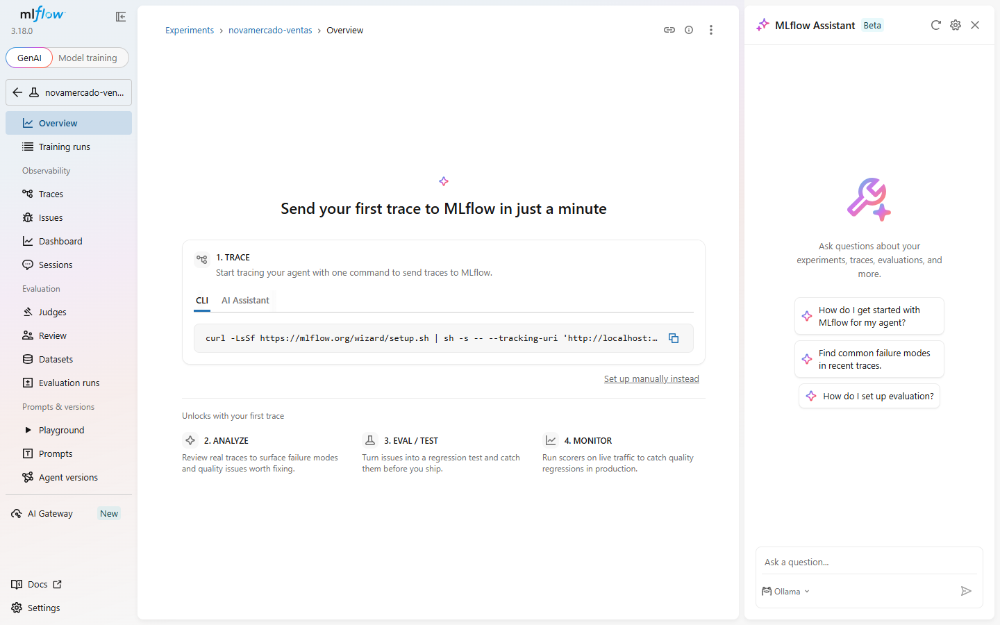
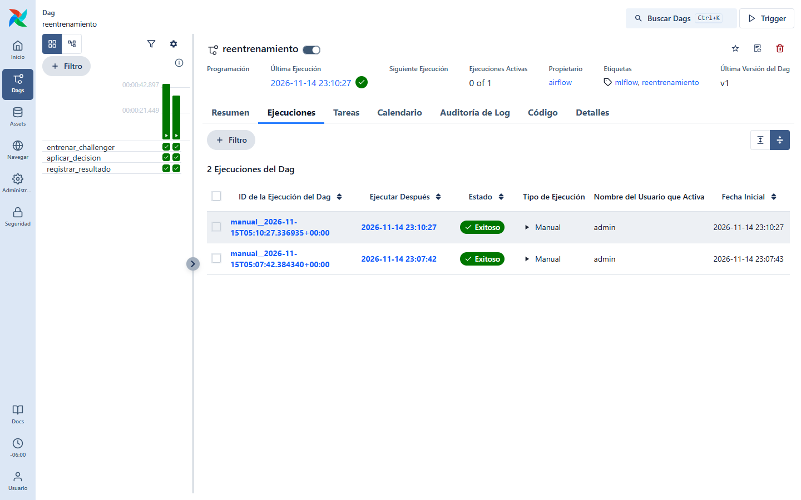

# Lab2_PD · Servicio de pronóstico diario de ventas · NovaMercado

Servicio de ML que recibe solicitudes de pronóstico de las tiendas, responde la venta
esperada y la cantidad sugerida por familia aunque los datos lleguen en mal estado, registra
lo que predice y lo que ocurre, y reentrena su modelo con esa información. Integra FastAPI,
PostgreSQL, MLflow y Apache Airflow y se levanta con un comando.

Decisiones técnicas y de producto: [DECISIONES.md](DECISIONES.md).

## Requisitos

- Docker Desktop (en Windows con WSL 2) con al menos 6 GB de RAM disponibles para Docker.
- Puertos libres: 8000 (API), 5000 (MLflow) y 8080 (Airflow).

## Levantar el producto desde cero

```bash
git clone https://github.com/Rodricsls/Lab2_PD.git && cd Lab2_PD
cp .env.example .env
```

1. Colocar los **archivos publicados en el GES** en **`datos/publicados/`**, sin renombrar:
   `tiendas.csv`, `familias.csv`, `historico_ventas.csv`, `feriados.csv`, `costos.csv`
   (y opcionalmente `catalogo_errores.md` y `ejemplos/`).
2. Solo en Linux: `sed -i "s/^AIRFLOW_UID=.*/AIRFLOW_UID=$(id -u)/" .env`
3. Levantar todo:

   ```bash
   docker compose up -d --build
   ```

Al levantarse desde cero el servicio `inicializador` carga el histórico en PostgreSQL y
entrena, registra y promueve el primer modelo (≈ 30 s). El producto está listo cuando
`GET /health` responde `"estado": "ok"` (≈ 1–2 min después de levantarse, sin contar la
construcción de imágenes). Al volver a levantarlo conserva datos y modelo y no repite ese
trabajo.

| Servicio | URL |
|---|---|
| API (documentación interactiva) | <http://localhost:8000/docs> |
| MLflow (experimentos y Model Registry) | <http://localhost:5000> |
| Airflow (usuario y clave de `.env`) | <http://localhost:8080> |

Detener sin perder nada: `docker compose down`. Borrar todo (datos, modelos e historial):
`docker compose down -v`.

## Contrato

| Endpoint | Qué hace |
|---|---|
| `POST /v1/prediccion` | Pronóstico de un día para una tienda: `venta_esperada` y `cantidad_sugerida` por familia, `version_modelo` y `calidad` |
| `POST /v1/observaciones` | Ventas reales de un día; idempotente (`registros_guardados` = nuevos o modificados) |
| `POST /admin/reentrenar` | Dispara el DAG de reentrenamiento → `202 {"id": ...}` (503 si no se puede) |
| `GET /admin/reentrenar/{id}` | `en_curso`, `exitoso` o `fallido`; al terminar, `promovido`, `version` y `motivo` |
| `GET /modelo` | Modelo vigente: `nombre`, `alias`, `version` |
| `GET /health` | `ok`, o `degradado` con `motivo` si falta una dependencia; 503 sin modelo |

Ejemplo:

```bash
curl -X POST localhost:8000/v1/prediccion -H "content-type: application/json" \
  -d @datos/publicados/ejemplos/errores/E01_tienda_texto.json
```

```json
{"tienda_id": 5, "fecha": "2025-11-17", "version_modelo": "1",
 "predicciones": [{"familia_id": "abarrotes", "venta_esperada": 991.8, "cantidad_sugerida": 1279}, "..."],
 "calidad": {"estado": "corregido", "observaciones": [
   {"campo": "tienda_id", "accion": "reparar", "detalle": "'T05' se interpretó como 5"}]}}
```

Política ante cada tipo de problema en los datos: [DECISIONES.md · D2](DECISIONES.md#d2--política-ante-datos-defectuosos).

## Estructura

```
src/novamercado/
  calidad.py        política reparar / advertir / rechazar
  features.py       features con ventas de días anteriores
  modelo.py         baseline, LightGBM, factor por familia, costo
  entrenamiento.py  entrenar, evaluar y criterio de reemplazo
  registro.py       MLflow: runs, Registry y alias
  operacion.py      arranque desde cero y pasos del reentrenamiento
  db.py             PostgreSQL del producto
  api/              FastAPI, esquemas Pydantic, recarga del modelo y salud
dags/               DAG de reentrenamiento
config/params.yaml  parámetros
docker/             Dockerfiles y dependencias con versiones fijas
tests/              pytest con datos sintéticos (sin MLflow, Postgres ni Airflow)
scripts/            simulación de la operación diaria
docs/evidencia/     capturas y respuestas reales de la API
```

## Pruebas

```bash
python -m venv .venv
.venv/Scripts/pip install -r docker/requirements-api.txt pytest ruff   # Linux/macOS: .venv/bin/pip
.venv/Scripts/python -m pytest -q
```

Las pruebas del contrato usan dependencias falsas y catálogos sintéticos: no necesitan
MLflow, PostgreSQL, Airflow ni los datos publicados. También corren en GitHub Actions en
cada Pull Request.

## Evidencia de funcionamiento

Producto levantado con `docker compose up -d --build` sobre los datos publicados y operado
con [scripts/simular_operacion.py](scripts/simular_operacion.py): 10 días posteriores al
histórico, 10 tiendas, ≈ 40 % de solicitudes con problemas (varios fuera del catálogo),
observaciones con un cambio de nivel de la demanda (+15 %) y un reentrenamiento final.

### Experimentos y versiones del modelo en MLflow

| Versión | Origen | Decisión | Motivo |
|---|---|---|---|
| 1 | arranque | promovido → hoy `@anterior` | Primer modelo: costo en validación 44 746 vs 55 922 del baseline |
| 2 | reentrenamiento sin datos nuevos | descartado | Costo 44 746 vs 42 425 del vigente (el vigente había visto la ventana; ver D5) |
| 3 | reentrenamiento tras 10 días de operación | promovido → `@champion` | Costo 36 641 vs 36 641 del vigente en los días que ninguno vio; mejora al baseline (37 279) |




### Ejecuciones del DAG de reentrenamiento



| Prueba | Resultado medido |
|---|---|
| Arranque desde cero → primer modelo registrado y promovido | ≈ 30 s (inicializador) |
| Reentrenamiento por `POST /admin/reentrenar` | 35–50 s, estado consultable en `GET /admin/reentrenar/{id}` |
| La API usa el modelo promovido sin reinicio | ≈ 20 s después de terminar |
| MLflow detenido | `/health` → `degradado` en 9 s; los pronósticos siguen respondiendo 200 |
| MLflow restablecido | `/health` → `ok` en 11 s |
| `docker compose down` + `up` (sin borrar volúmenes) | `ok` en 63 s, mismo modelo (v3) y mismas observaciones, sin reentrenar |

### Respuestas de la API ante solicitudes válidas y defectuosas

Solicitudes y respuestas completas en [docs/evidencia/ejemplos_api.json](docs/evidencia/ejemplos_api.json).

| Solicitud | HTTP | `calidad.estado` | Observación |
|---|---|---|---|
| Válida | 200 | ok | — |
| `"tienda_id": "T05"` | 200 | corregido | reparar: 'T05' se interpretó como 5 |
| `"store_id"` en vez de `tienda_id` | 200 | corregido | reparar: el campo 'store_id' se interpretó como 'tienda_id' |
| `"BEBIDAS"`, `"  Abarrotes "` | 200 | corregido | reparar: se interpretó como 'bebidas' / 'abarrotes' |
| `"en_promocion": "2"`, `"2,0"` | 200 | corregido | reparar: se interpretó como 2 |
| `"fecha": "2026-03-06T00:00:00Z"` | 200 | corregido | reparar: se interpretó como 2026-03-06 |
| `"fecha": "10/03/2026"` (ambigua) | 200 | advertencia | advertir: se asumió día/mes (2026-03-10) |
| Faltan 2 familias | 200 | advertencia | advertir: se pronosticaron asumiendo 0 productos en promoción |
| Campo desconocido `"canal"` | 200 | advertencia | advertir: campo desconocido 'canal': se ignoró |
| Tienda 99 | 422 | — | `detail`: La tienda 99 no existe en el catálogo. |
| Observación del día | 200 | ok | `registros_guardados`: 12 |
| La misma observación reenviada | 200 | ok | `registros_guardados`: 0 |
